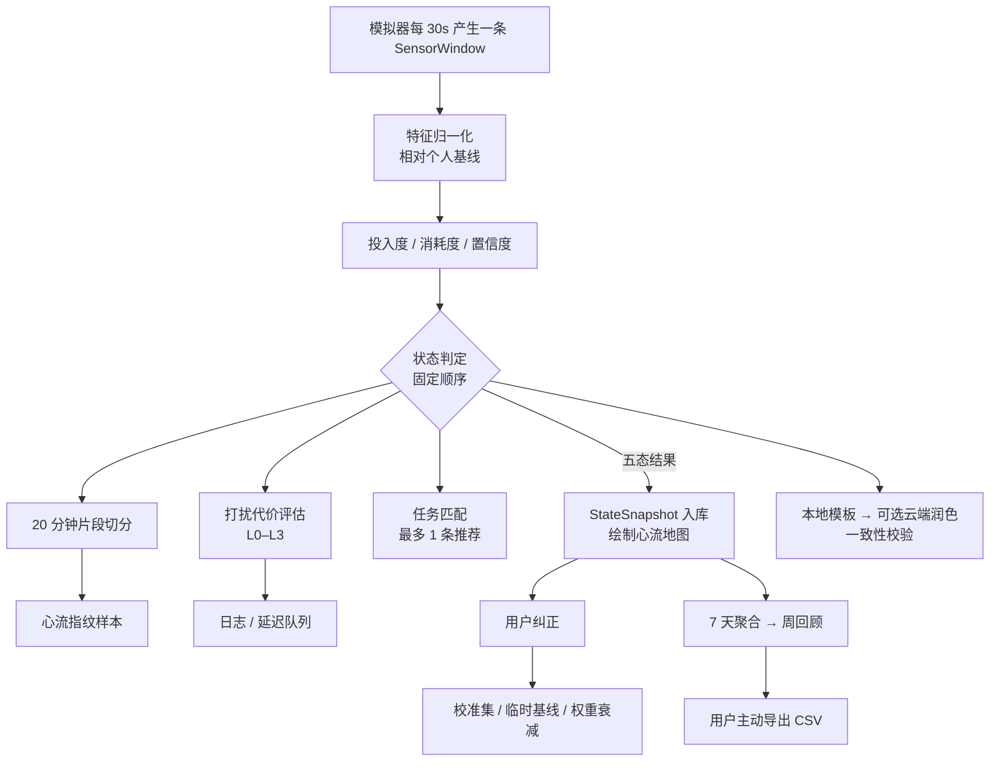

<div align="center">

# 心流回响 · Flow Echo

**把"我学得很累但不知道累在哪"变成一张看得见的心流地图**

一个完全在手机本地运行的 Flutter 学习状态感知应用<br>
不接管表、不连耳机、不上传原始数据，飞行模式下也能工作

[](https://flutter.dev)
[](https://dart.dev)
[]()
[]()
[]()
[]()

全国大学生软件创新大赛 · AI + 健康方向

</div>

---

## 一、为什么做这个

自习室里最常见的两种失败，都不是"不努力"：

- **空转**：坐了三小时，心率偏高、手指不动、一行字没进脑子——自己却以为在学。
- **苦撑**：投入还在，但 HRV 一路掉、久坐超一小时——效率已经崩了，人还在硬扛。

这两件事的共同点是：**当事人感知不到**。市面上的产品要么等你事后打卡，要么直接给你一个"精力分数"，既不解释也不可反驳。

心流回响换了一个做法：**不评判你，只把手上的证据摊开给你看，然后让你自己改。** 每一次"不对"都会被记成一次校准，模型随你修正——而不是反过来教你怎么学习。

---

## 二、核心设计

### 1. 心流地图：二维坐标代替单一分数

| 轴 | 含义 | 取值 |
|---|---|---|
| X 投入度 | 输入活跃、低切换、连续性、低解锁、场景相关性加权 | 0 – 1 |
| Y 消耗度 | HRV 下降、心率负荷、久坐、持续时长加权 | 0 – 1 |

四个象限 + 一条模糊带构成完整状态空间：

```
消耗度 ↑
        │  苦撑 struggle       │  攻坚 challenge
        │  （低投入·高消耗）    │  （高投入·高消耗）
  0.55  ├──────────模糊带 0.45–0.55──────────┤
        │  空转 idle           │  顺流 flow
        │  （三条件同时成立）   │  （高投入·低消耗）
        └──────────────────────────────→ 投入度
          0                        0.55        1
```

**第五种状态是"模糊"**，它不是兜底词，而是必须带原因的一等公民：`数据量不足` / `生理与输入特征冲突` / `坐标位于象限边界` / `数据特征不明显`。宁可承认看不清，也不硬猜。

### 2. 空转判定：只认三条件同时成立

```
心率 > 个人基线 + 5
且 输入活跃度 < 0.25
且 久坐 ≥ 40 分钟
```

缺任意一项都**不返回空转**。低投入 + 低消耗 ≠ 空转——这条边界是整个产品可信度的地基。

### 3. 反馈即标注：把用户的"不对"变成训练数据

用户点"不对"，只给三个选项：**不是这个状态 / 场景标签错了 / 数据不准**。三种纠正分别触发：

- 象限边界向修正方向平移 `0.02`
- 该片段训练权重乘以 `0.5`
- 字段做一次小步长 EWMA 更新，权重乘以 `0.6`

纠正不覆盖历史，而是写入 `correction` 表 + 生成 7 天临时基线，可撤销、可审计。界面显示的不是"准确率"，而是**校准集一致率**。

### 4. 学习片段与心流指纹

- 连续学习满 **20 分钟**切一条片段；60 分钟出 3 条；娱乐场景不参与训练；切场景立即结算。
- 样本 **≥ 20 条且跨度 ≥ 14 天**才允许输出指纹，否则只显示"观察中"并告诉你还差多少。
- 离线用逻辑回归训练 → 导出 `.tflite` → 端侧 `tflite_flutter` 推理，**手机端不做在线训练**。
- 每条陈述必须附支持样本数，不附样本数的话不说。

### 5. 打扰的机会成本调度

推送不是"到点就发"，而是先算代价再决定说不说：

| 等级 | 行为 | 是否消耗每日预算 |
|---|---|---|
| L0 | 完全静默，只记录 | 否 |
| L1 | 应用内轻提示 | 否 |
| L2 | 系统通知 | 是 |
| L3 | 强打扰（仅极端场景） | 是 |

预算耗尽后进入延迟队列，等到象限跳变的自然间隙再投递，并保留完整通知日志说明"为什么发/为什么不发"。

### 6. 文案双通路

本地模板永远是主路径；云端只负责润色语气，**3 秒超时无感降级**，且回包必须通过状态一致性校验——云端改错状态，客户端直接拒收。

---

## 三、功能一览

| 模块 | 已冻结功能 |
|---|---|
| 状态感知 | 四场景切换、投入/消耗/置信度、五态判定、模糊原因 |
| 心流地图 | CustomPainter 手绘、拖动修正、模糊带、置信度圈 |
| 反馈校准 | 三选一纠正、临时基线、撤销、7 天纠正次数、一致率变化 |
| 片段与指纹 | 20 分钟切片、娱乐排除、TFLite 指纹、观察中门槛 |
| 推荐 | 单一任务匹配（高/中/低认知负荷）、恢复活动增益排行 |
| 打扰 | 机会成本公式、L0–L3、每日预算、延迟队列、通知日志 |
| 回顾与导出 | 周回顾（"仅统计 X 天"）、用户主动导出 CSV |
| 调试 | 五剧本切换、时间加速、一键生成 28 天演示数据 |

---

## 四、技术栈

| 层 | 选型 | 说明 |
|---|---|---|
| UI | Flutter | Android 内测 APK 主路径 |
| 状态管理 | Riverpod | 模拟器 / 数据库 / 判定 / 调度各自独立 Provider |
| 路由 | go_router | 首页、历史、指纹、周回顾、设置 |
| 存储 | sqflite + SQLite | 状态、片段、纠正、任务、调度记录 |
| 绘图 | CustomPainter | 不引图表库，换取手势拖拽与象限标注自由度 |
| 推理 | tflite_flutter | 端侧推理个人指纹概率 |
| 训练 | Python + scikit-learn + TensorFlow | 离线训练，导出 `.tflite` |
| 计算 | 纯 Dart | 运行时判定全部在端侧完成 |
| 测试 | flutter_test + integration_test | 单元 / Widget / 集成 |
| 可选云端 | HTTP | 仅润色文案，3 秒超时降级 |

**运行环境**：`minSdk 23`（Android 6.0）、`targetSdk 35`，包名 `cn.team.flow_echo`。

---

## 五、运行时数据流



---

## 六、目录结构

```text
flow_echo/
├── assets/
│   ├── data/            # 恢复活动库、演示种子
│   └── models/          # flow_fingerprint.tflite + meta
├── lib/
│   ├── core/            # 常量、时间工具
│   ├── data/            # 数据库、五类 Repository
│   ├── domain/
│   │   ├── models/      # SensorWindow、StateSnapshot、Correction…
│   │   ├── engine/      # 特征、判定、切片、纠正
│   │   ├── scheduler/   # 代价公式、预算、延迟队列
│   │   ├── recommendation/  # 任务匹配、恢复增益、文案
│   │   └── fingerprint/ # 门槛、推理、陈述生成
│   ├── features/        # home / correction / tasks / fingerprint / history / review / settings / debug
│   └── simulation/      # 生理数据模拟器与剧本
├── tools/               # 训练、评估、演示数据导出脚本
├── test/                # 5 组单元测试
└── integration_test/    # 3 分钟演示闭环
```

---

## 七、快速开始

```bash
# 1. 克隆
git clone https://github.com/JackyMa2007/flow_echo.git
cd flow_echo

# 2. 依赖
flutter pub get

# 3. 跑起来（连接安卓设备或已建好的模拟器）
flutter run
```

环境自检（Android toolchain 和 connected device 必须先通过）：

```bash
git --version && flutter --version && flutter doctor -v && java -version && python --version
```

提交前固定跑一遍：

```bash
flutter format . && flutter analyze && flutter test && flutter test integration_test
```

打内测包：

```bash
flutter clean && flutter pub get && flutter build apk --release
# 产物：build/app/outputs/flutter-apk/app-release.apk
```

> 签名文件与 `android/key.properties` 不入库，已在 `.gitignore` 中排除。

---

## 八、演示模式

Beta 阶段所有数据来自**模拟器**，界面全局常驻提示条：

> 演示模拟数据，仅用于产品功能验证

调试面板（仅 debug 构建可见）可一键切换顺流 / 攻坚 / 空转 / 苦撑 / 模糊五套剧本、加速时间、生成 28 天演示记录（24 条学习片段、3 次纠正、2 成功 1 失败恢复、4 次 L2 打扰）。所有演示记录强制带 `data_source = simulated`，导出 CSV 时一并保留——**演示数据不允许伪装成真实采集**。

完整演示路径约 3 分钟：状态 → 空转证据 → "不对"纠正 → 基线变化 → 切场景结算 → 指纹观察中 → 断网降级 → 单一推荐 → 周回顾 → CSV 导出。

---

## 九、我们刻意不做的事

这不是能力缺失，是产品立场：

- 不把模拟数据说成真实生理监测
- 不把状态判断写成医学诊断，不输出抑郁 / 焦虑 / 疾病风险结论
- 不给努力程度打分，不做排名与奖惩，不承诺提高成绩
- 不自动上传原始数据，手机端不做在线训练
- 不做真实硬件的占位页面
- 不把空转退化成单条件规则

---

## 十、进度与路线图

**当前：Beta V0.1（第 1 周施工中）**

- [x] 仓库初始化、跨设备（Windows / macOS）协同开发流程
- [x] Flutter 工程骨架、依赖冻结
- [ ] Android 打包配置（applicationId / minSdk / targetSdk）
- [ ] SQLite 七张核心表 + 迁移脚本
- [ ] 生理数据模拟器与"演示模拟数据"标识
- [ ] FeatureExtractor + StateEngine（含空转三条件测试）
- [ ] 心流地图绘制与拖动纠正
- [ ] 20 分钟切片 + TFLite 指纹接入
- [ ] 打扰调度、预算与延迟队列
- [ ] 周回顾、CSV 导出
- [ ] 28 天演示数据彩排 → Release APK 内测

---

## 十一、说明

本项目为**竞赛与教学用途**的 Beta 版本，生理信号为模拟数据，状态判定为可解释的工程规则与轻量模型，**不构成任何健康、医疗或心理建议**。

项目代码与文档版权归团队所有；如需引用或合作，请通过 Issue 联系。
</content>
</invoke>
